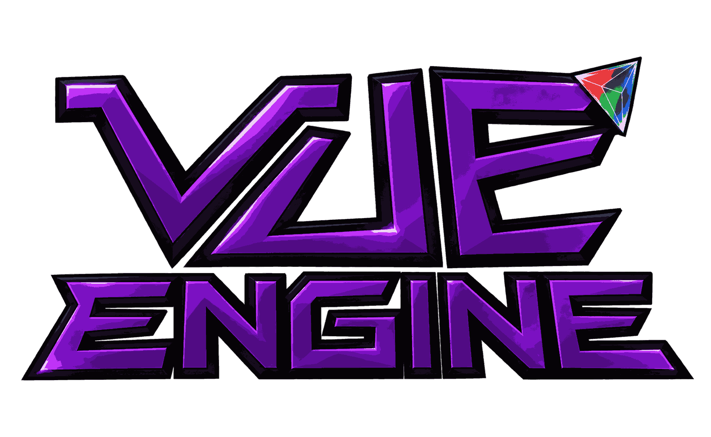

<p align="center"></p>

# Vue Engine

A 2D and 3D game creation engine for Windows. Build games three ways and run them instantly.

- **Blocks**: Scratch-style drag and drop blocks
- **Nodes**: visual node graphs with execution and data wires
- **Code**: typed TypeScript with live type checking in the editor

All three compile to the same runtime, so one project can mix them per entity.

## Features

- 2D and 3D scenes in one project, switchable per scene
- 3D: Three.js rendering, shadows, lights, orbit camera editor, third-person and first-person cameras, mouse look, 3D collisions
- Project hub with playable templates, recent projects and thumbnails
- Scene editor with move, rotate and scale gizmos, smart guides, snapping, grid, undo and redo
- 3D transform gizmos, axis view cube, orbit and fly camera
- Tilemap painter with brush, rectangle, fill, eraser and picker, plus solid-tile collisions
- Sprite animation editor with sheet slicing, frame timeline and live preview
- Cutscene editor: camera moves, captions, speech, sounds, tweens and events on a timeline
- Parent/child entities in 2D and 3D, with drag-to-parent in the Hierarchy
- Audio sources, music, sound effects with waveform previews
- 140+ blocks covering the whole scripting API, plus lists, text, math and functions
- Command palette (Ctrl+P), resizable panels, filterable console, status bar
- Play inside the editor with pause, step, resolution presets, or in its own window
- Multiple scenes, prefabs and runtime spawning
- Fixed timestep game loop, spatial hash collisions, static, dynamic and trigger bodies
- Camera follow and shake, particles, HUD, sound beeps and audio assets
- Image and audio asset import
- Export any project as a single playable HTML file
- Single portable `VueEngine.exe`, no installer

## VWR core

VWR (Vender WASM Rust) is Vue's native physics core. The collision solver is written in C++, the spatial hash broadphase in Rust, and both are linked into one 5 KB WebAssembly module (`vwr/`). It produces the exact same results as the JavaScript path and runs about 1.5 to 2x faster on large scenes. Switch it under Project → Engine core. Rebuild with `npm run build:vwr` (needs clang, wasm-ld and Rust with the wasm32 target).

## Porting

The Port button builds your game as:

- a single HTML file
- a web game ZIP (index.html, game.js, assets) for itch.io or GitHub Pages
- an installable web app (PWA) ZIP with manifest, icons and offline cache
- a desktop app folder with its own executable
- a Vue project file for sharing the source

## Controls

| Action | Key |
| --- | --- |
| Play | Ctrl+Enter |
| Port game | Ctrl+E |
| Save | Ctrl+S |
| Undo / Redo | Ctrl+Z / Ctrl+Y |
| Duplicate | Ctrl+D |
| Pan scene | Space + drag, or middle mouse |
| Debug overlay in game | F3 |

## Code API

```ts
export function start(): void {}
export function update(dt: number): void {}
export function collide(other: Entity): void {}
export function click(): void {}
```

Globals: `vue` (input, find, spawn, camera, hud, beep, wait, go) and `self` (the entity).

## Credits

Icons by Lucide (ISC). 3D rendering by three.js (MIT). Blocks by Blockly (Apache 2.0). Code editor by Monaco (MIT). Fonts Inter and JetBrains Mono (OFL).

## Build

```
npm install
npm test
npm start
npm run dist
```

Every push to `main` builds `VueEngine.exe` on GitHub Actions and publishes it as a release.
